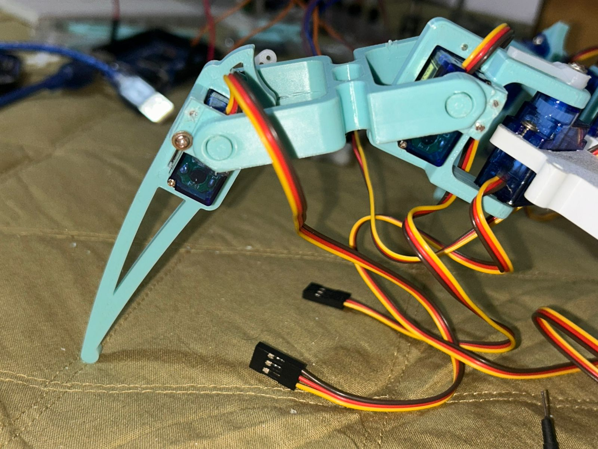
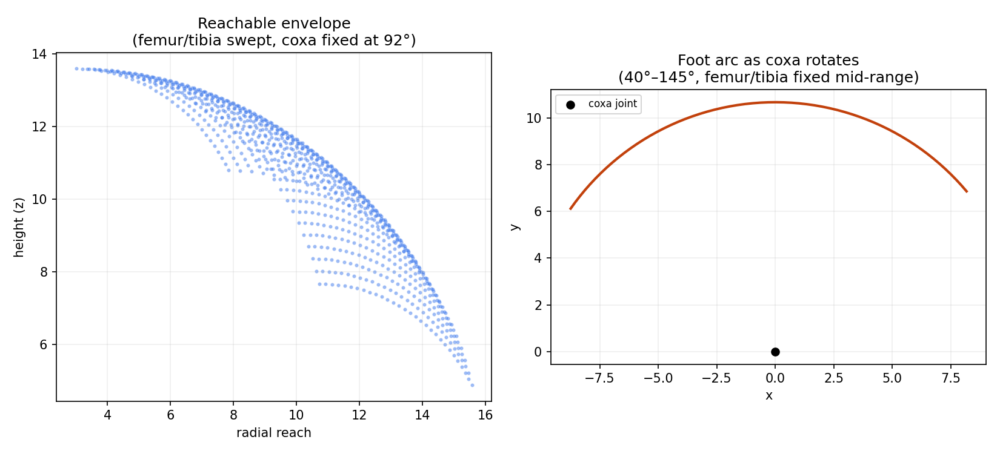
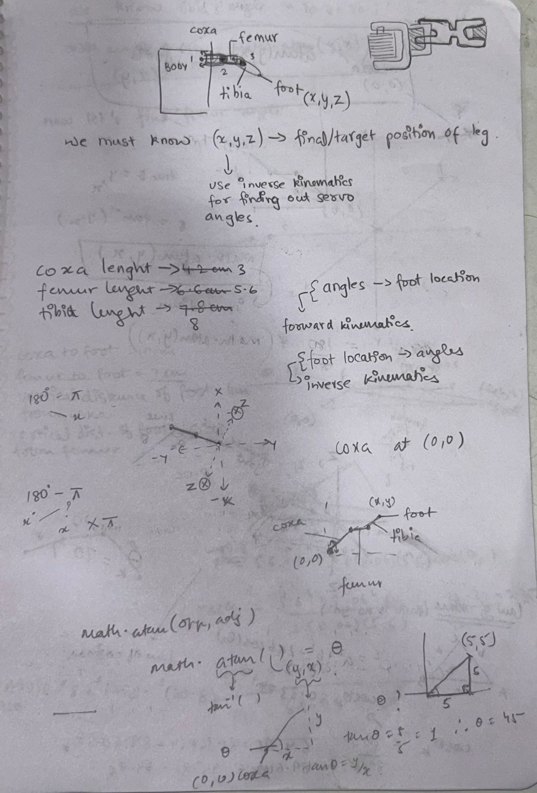

# Quadruped Leg Kinematics

A small Python OOP framework for computing **forward and inverse kinematics** of a 3-DOF (coxa–femur–tibia) robot leg — the standard joint layout used on most hobbyist quadruped and hexapod robots.

## Overview

Each leg has three revolute joints:

- **Coxa** — rotates the whole leg around the vertical (yaw) axis, sweeping it left/right.
- **Femur** — the upper leg segment, swings in the vertical plane to set reach and height.
- **Tibia** — the lower leg segment, attached at the knee, also swings in the vertical plane.

Given the three joint angles and link lengths, **forward kinematics** computes where the foot ends up in 3D space. Given a target foot position, **inverse kinematics** computes the joint angles needed to get there (or reports that the target is out of reach).

<p align="center">
  
</p>

## Class Reference

### `Servo` (`src/servo.py`)

A simple software model of a hobby servo — tracks its allowed range and current angle, and simulates moving toward a target angle in fixed-size steps.

```python
from servo import Servo

s = Servo(min_ang=20, max_ang=90, current_ang=45)
s.move_to(target_ang=80, step_ang=5)   # steps from 45 -> 80 in increments of 5
```

If the target angle is outside `[min_ang, max_ang]`, `move_to` returns `'Servo cannot move to the target angle'` instead of moving.

### `Leg` (`src/leg.py`)

```python
Leg(coxa_angle, femur_angle, tibia_angle, coxa, femur, tibia)
```

| Parameter | Meaning |
|---|---|
| `coxa_angle`, `femur_angle`, `tibia_angle` | Current joint angles, in **degrees** |
| `coxa`, `femur`, `tibia` | Link lengths (any consistent unit, e.g. cm) |

**`forward_kinematics()`** → returns the foot position as a string `"(x, y, z)"`, computed from the leg's current joint angles and link lengths.

**`inverse_kinematics(x, y, z)`** → returns a `(coxa_angle, femur_angle, tibia_angle)` tuple that places the foot at the target point, or the string `'Target position is unreachable'` if the point is outside the leg's physical reach (checked against `femur + tibia` and `|femur - tibia|`).

## The Math

**Forward kinematics** treats the femur and tibia as vectors in the vertical plane (each contributing a horizontal and vertical component), sums them into a single radial reach, then rotates that reach by the coxa angle to get `x, y`:

```
xf, zf = femur * cos(femur_angle), femur * sin(femur_angle)
xt, zt = tibia * cos(tibia_angle), tibia * sin(tibia_angle)
radial_reach = coxa + xf + xt
x, y = radial_reach * cos(coxa_angle), radial_reach * sin(coxa_angle)
z = zf + zt
```

**Inverse kinematics** works backward using the law of cosines on the femur–tibia–target triangle:

1. `coxa_angle` — direction to the target in the XY plane (`atan2(y, x)`)
2. `target_line` — straight-line distance from the femur joint to the target, in the vertical plane
3. `knee_angle` — angle at the knee, from the law of cosines on sides `femur`, `tibia`, `target_line`
4. `femur_angle` — the angle of elevation to the target (`alpha`) plus the angle between the femur and the target line (`beta`)
5. `tibia_angle` — derived from `femur_angle` and `knee_angle`

> **Note:** for any reachable point there are generally *two* valid joint-angle solutions — like the "elbow-up" vs. "elbow-down" configurations on a robot arm. This implementation always resolves to one specific branch (the one matching a forward-bending knee), which is what real hexapod/quadruped builds typically use. This means feeding a foot position straight back through `inverse_kinematics()` won't always return the exact same angles that produced it — it may return the other valid solution instead. Both place the foot at the same point.

## Hardware Build

<p align="center">
  <br>
  <em>Fully assembled quadruped — four 3-DOF (coxa/femur/tibia) legs on a central body plate</em>
</p>

<p align="center">
  <br>
  <em>Close-up of a single leg: coxa, femur, and tibia servos with 3D-printed links</em>
</p>

The frame and all four legs are assembled. It isn't walking yet — there are some hardware issues still being worked through — but the mechanical structure this kinematics math was written for is real and built. NOTE : ## Mechanical Design Attribution

The quadruped's mechanical design and 3D-printable chassis are based on an existing design created by **Maker 101**. The original design files can be found at [https://www.pcbway.com/project/shareproject/Quadruped_Spider_Robot_3D_Printed_Parts_SG90_Servo_Motor_Arduino_Nano_10107fe3.html](https://www.pcbway.com/project/shareproject/Quadruped_Spider_Robot_3D_Printed_Parts_SG90_Servo_Motor_Arduino_Nano_10107fe3.html).

Credit for the mechanical design belongs to the original creator. My work focuses on developing a custom Python-based forward and inverse kinematics framework and exploring locomotion control and AI integration for the quadruped platform.

The original design is used in accordance with its applicable license.


## Requirements

`src/leg.py` and `src/servo.py` need only the Python standard library. `examples/visualize_workspace.py` additionally needs `numpy` and `matplotlib`:

```bash
pip install -r requirements.txt
```

## Reachable Workspace

Since `servo.py`'s joint limits (coxa: 40°–145°, femur: 30°–90°, tibia: 15°–90°) are already defined in `leg.py`, I swept `forward_kinematics()` across those limits to plot what the leg can actually reach:

<p align="center">
  
</p>

Left: the envelope of every reachable (radial reach, height) combination as femur and tibia sweep through their full range, with coxa held fixed. Right: the arc the foot traces in the XY plane as the coxa sweeps through its full 40°–145° range, with femur/tibia held at mid-range.

Regenerate this yourself with:
```bash
python examples/visualize_workspace.py
```

## Derivation: Solving a Worked Example

This walks through the inverse kinematics math step by step, using one concrete target point — the same example worked out by hand in the notebook pages in [`/notes`](./notes). Chosen link lengths: **coxa = 3 cm, femur = 5.6 cm, tibia = 8 cm.** Target foot position: **(x, y, z) = (8, 6, −4) cm.**

<p align="center">
  
  
</p>

The full set of pages (7 in total) is in [`/notes`](./notes) if you want to see the raw derivation, including a couple of dead ends and re-checks — that's normal, and honestly a more useful record than a clean final version.

### Step 1 — Coxa angle: which way does the leg need to turn?

Looking straight down at the leg from above, the coxa only rotates the leg left/right around a vertical axis. That angle is just the direction to the target in the X-Y plane:

```
coxa_angle = atan2(y, x) = atan2(6, 8) ≈ 36.87°
```

### Step 2 — Collapse the 3D problem into a 2D triangle

Once the leg is turned to face the target, the femur and tibia only need to solve a **2D problem**: reach a point that's some horizontal distance away and some height above/below the femur joint. So the next step is figuring out that horizontal distance and height:

```
distance from coxa to foot (straight line, ignoring height) = sqrt(x² + y²) = sqrt(8² + 6²) = 10 cm
horizontal distance from femur joint to foot = 10 − coxa = 10 − 3 = 7 cm
height difference (z) = −4 cm   (foot is 4 cm below the femur joint)
```

That horizontal distance and height form a right triangle, so the **straight-line distance from the femur joint to the foot** (call it the "target line") is:

```
target_line = sqrt(7² + (−4)²) = sqrt(65) ≈ 8.06 cm
```

This also tells us right away whether the target is even reachable: the femur and tibia can only reach a target line between `|femur − tibia|` and `femur + tibia`. Here, `2.4 ≤ 8.06 ≤ 13.6`, so it's reachable.

### Step 3 — Knee angle, via the law of cosines

Now there's a triangle with three known sides: **femur (5.6), tibia (8), and target_line (8.06)**. The angle at the knee — between the femur and tibia links — is opposite the target_line side, so the law of cosines gives it directly:

```
target_line² = femur² + tibia² − 2(femur)(tibia)·cos(knee_angle)
cos(knee_angle) = (5.6² + 8² − 8.06²) / (2 · 5.6 · 8) ≈ 0.339
knee_angle ≈ 70.2°
```

### Step 4 — Femur angle, in two parts

The femur's angle (relative to horizontal) is the sum of two smaller angles:

- **alpha** — how far the target line itself tilts up or down from horizontal:
  ```
  alpha = atan2(z, horizontal_distance) = atan2(−4, 7) ≈ −29.7°
  ```
- **beta** — the angle *between* the femur link and that target line, again from the law of cosines (this time solving for the angle opposite the tibia side):
  ```
  cos(beta) = (femur² + target_line² − tibia²) / (2 · femur · target_line) ≈ 0.358
  beta ≈ 69.0°
  ```

```
femur_angle = alpha + beta ≈ −29.7° + 69.0° ≈ 39.3°
```

### Step 5 — Tibia angle

The tibia's angle is defined relative to the femur: reverse the femur's direction (+180°) and rotate further by the knee angle:

```
tibia_angle = (femur_angle + 180 + knee_angle) mod 360
            = (39.3 + 180 + 70.2) mod 360
            ≈ 289.5°
```

### Result

```
(coxa_angle, femur_angle, tibia_angle) ≈ (36.9°, 39.3°, 289.5°)
```

Running the actual code on this exact example confirms it:

```python
>>> from leg import Leg
>>> Leg(0, 0, 0, coxa=3, femur=5.6, tibia=8).inverse_kinematics(8, 6, -4)
(36.87, 39.25, 289.45)
```

### A wrinkle worth knowing about: the above/below case

The notebook pages work out an explicit rule for whether the target is *above* or *below* the femur joint's horizontal line ([`page5`](./notes/page5_above_below_case_analysis.jpeg)):

- if **below** the line: `femur_angle = beta + alpha`
- if **above** the line: `femur_angle = beta − alpha`

But the code doesn't branch on this at all — it always computes `alpha = atan2(z, horizontal_distance)`, and `atan2` automatically returns a *negative* angle when `z` is negative. That has the effect of always **subtracting** when the target is below the line and **adding** when it's above — which is the *opposite* of the rule in the notes. Both approaches are internally consistent; they just don't currently agree with each other. This is worth double-checking once the physical femur servo direction is confirmed on hardware (once the current issues are sorted out) — it's an easy thing to verify by comparing which way the leg actually swings against which way the math says it should.

## Usage Example

See [`examples/demo.py`](./examples/demo.py) for a full runnable example:

```bash
python examples/demo.py
```

```python
from leg import Leg

leg = Leg(coxa_angle=0, femur_angle=45, tibia_angle=90, coxa=3, femur=5.6, tibia=8)

leg.forward_kinematics()               # -> '(6.96, 0.0, 11.96)'
leg.inverse_kinematics(8, 2, -4)       # -> (14.04, 44.21, 278.86)
leg.inverse_kinematics(50, 0, 0)       # -> 'Target position is unreachable'
```

## Project Structure

```
quadruped-leg-kinematics/
├── README.md
├── LICENSE
├── .gitignore
├── src/
│   ├── leg.py      # Leg class: forward_kinematics() and inverse_kinematics()
│   └── servo.py    # Servo class: simple simulated servo with move_to()
├── examples/
│   ├── demo.py                    # Runnable usage example
│   └── visualize_workspace.py     # Generates the workspace plot below
├── diagrams/
│   ├── leg_kinematics_diagram.svg
│   └── workspace_visualization.png
├── media/
│   └── images/
│       ├── quadruped_full_build.jpeg
│       └── leg_closeup.jpeg
└── notes/
    ├── page1_leg_geometry_and_intro.jpeg
    ├── page2_tibia_and_femur_angle_setup.jpeg
    ├── page3_coxa_formula_and_law_of_cosines.jpeg
    ├── page4_knee_and_femur_angle_solve.jpeg
    ├── page5_above_below_case_analysis.jpeg
    ├── page6_summary_and_coxa_angle.jpeg
    └── page7_knee_angle_and_joint_convention.jpeg
```

## Known Issues / Work in Progress

- At the bottom of `leg.py`, `leg1 = Leg(coxa, femur, tibia, 3, 5.6, 8)` passes the three `Servo` objects into the *angle* parameters instead of the *length* parameters — it looks like leftover code from wiring `Servo` into `Leg`, and will raise a `TypeError` if run as-is (math functions can't operate on a `Servo` object). Use the pattern in [`examples/demo.py`](./examples/demo.py) instead, or let me know if you'd like `Leg` refactored to properly accept `Servo` instances (which would let it enforce each joint's min/max angle automatically during IK).
- Both `servo.py` and `leg.py` currently run demo code at **import time** (the module-level `servo1 = Servo(...)` / `leg1 = Leg(...)` lines execute as soon as the file is imported). Worth wrapping those in `if __name__ == "__main__":` guards so importing the classes elsewhere doesn't trigger side effects or errors.

## Roadmap

- [ ] Integrate `Servo` instances into `Leg` so joint limits are enforced automatically during IK
- [ ] Add a `Quadruped` class to coordinate all four legs together
- [ ] Basic gait generation (trot, walk, etc.)
- [ ] Unit tests for FK/IK accuracy and edge cases
- [ ] Live visualization of leg position (e.g. matplotlib animation)

## License

This project is licensed under the MIT License — see [LICENSE](./LICENSE) for details.
