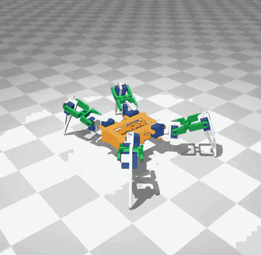
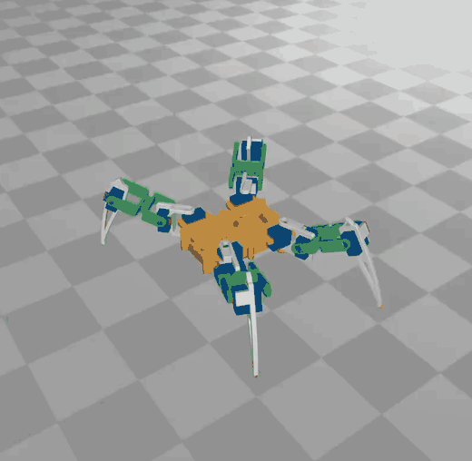
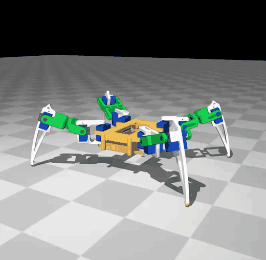
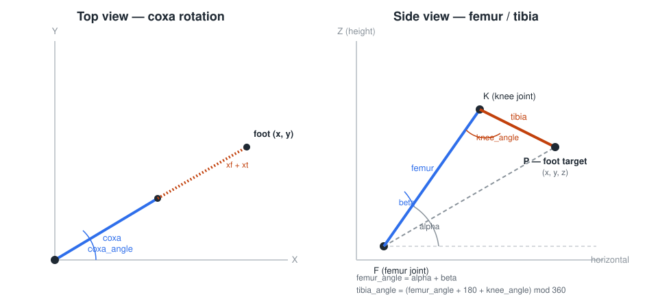
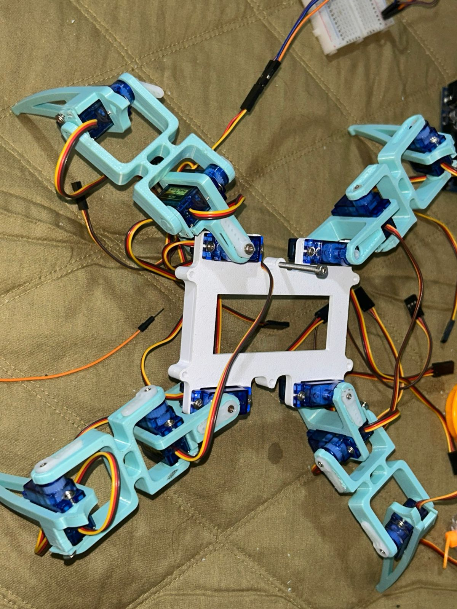
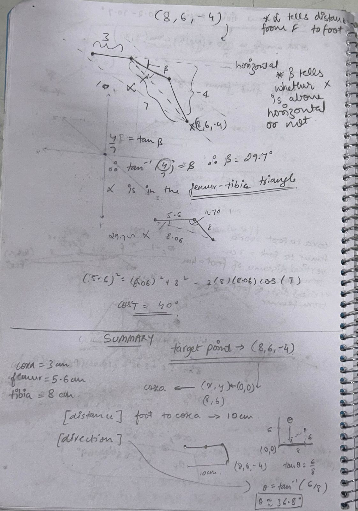
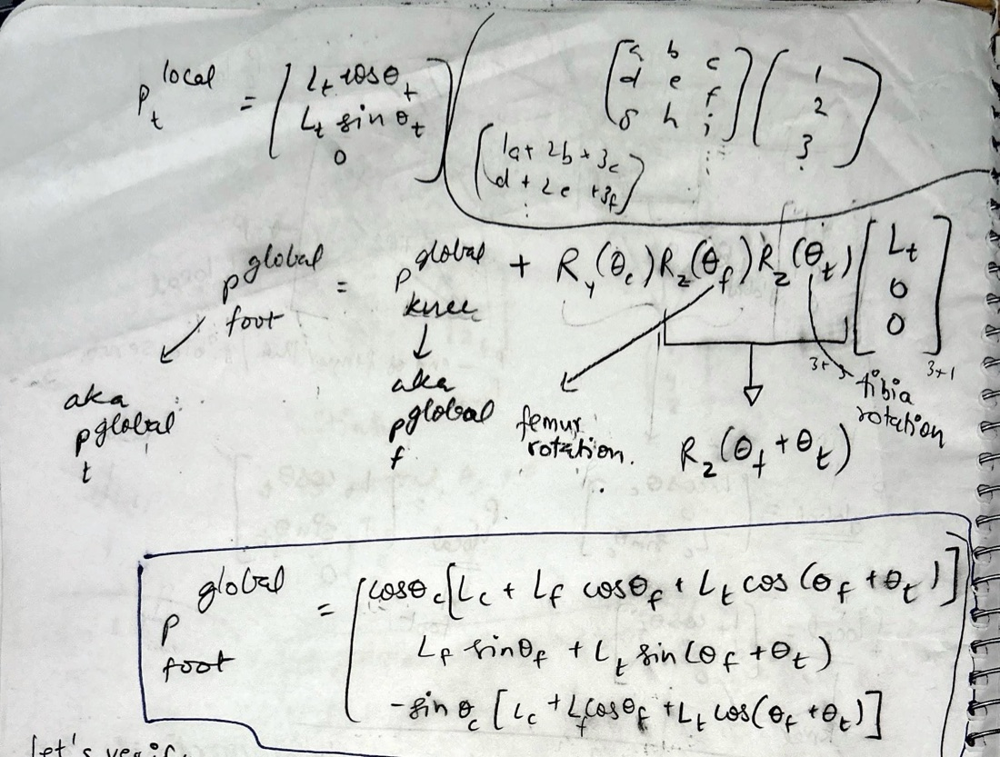
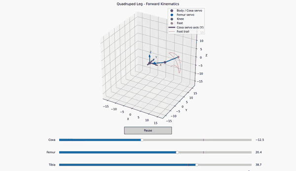

# Quadruped Leg Kinematics

A small Python OOP framework for computing **forward and inverse kinematics** of a 3-DOF (coxa–femur–tibia) robot leg — the standard joint layout used on most hobbyist quadruped and hexapod robots — plus a **3D NumPy forward-kinematics model**, an **animated Matplotlib visualizer**, and a **MuJoCo physics simulation** of the full robot that walks, turns, and jumps.

| | |
|---|---|
| [`src/`](./src) | Original `Leg` / `Servo` classes: FK, IK, simulated servo |
| [`fk3d/`](./fk3d) | 3D forward kinematics with rotation matrices, and an animated Matplotlib visualizer |
| [`mujoco_sim/`](./mujoco_sim) | MuJoCo model built from the printed STL parts; walking, turning and jumping |

<p align="center">
  <a href="./media/videos/quadruped-walking.mp4"></a>
  <a href="./media/videos/quadruped-turning.mp4"></a>
  <a href="./media/videos/quadruped-jumping.mp4"></a><br>
  <em>Walking · Turning (3× speed) · Jumping in MuJoCo. Click any animation for the full-length video.</em>
</p>

## Overview

Each leg has three revolute joints:

- **Coxa** — rotates the whole leg around the vertical (yaw) axis, sweeping it left/right.
- **Femur** — the upper leg segment, swings in the vertical plane to set reach and height.
- **Tibia** — the lower leg segment, attached at the knee, also swings in the vertical plane.

Given the three joint angles and link lengths, **forward kinematics** computes where the foot ends up in 3D space. Given a target foot position, **inverse kinematics** computes the joint angles needed to get there (or reports that the target is out of reach).

<p align="center">
  
</p>

## Class Reference

### `Servo` (`src/servo.py`)

A simple software model of a hobby servo — tracks its allowed range and current angle, and simulates moving toward a target angle in fixed-size steps.

```python
from servo import Servo

s = Servo(min_ang=20, max_ang=90, current_ang=45)
s.move_to(target_ang=80, step_ang=5)   # steps from 45 -> 80 in increments of 5
```

If the target angle is outside `[min_ang, max_ang]`, `move_to` returns `'Servo cannot move to the target angle'` instead of moving.

### `Leg` (`src/leg.py`)

```python
Leg(coxa_angle, femur_angle, tibia_angle, coxa, femur, tibia)
```

| Parameter | Meaning |
|---|---|
| `coxa_angle`, `femur_angle`, `tibia_angle` | Current joint angles, in **degrees** |
| `coxa`, `femur`, `tibia` | Link lengths (any consistent unit, e.g. cm) |

**`forward_kinematics()`** → returns the foot position as a string `"(x, y, z)"`, computed from the leg's current joint angles and link lengths.

**`inverse_kinematics(x, y, z)`** → returns a `(coxa_angle, femur_angle, tibia_angle)` tuple that places the foot at the target point, or the string `'Target position is unreachable'` if the point is outside the leg's physical reach (checked against `femur + tibia` and `|femur - tibia|`).

## The Math

**Forward kinematics** treats the femur and tibia as vectors in the vertical plane (each contributing a horizontal and vertical component), sums them into a single radial reach, then rotates that reach by the coxa angle to get `x, y`:

```
xf, zf = femur * cos(femur_angle), femur * sin(femur_angle)
xt, zt = tibia * cos(tibia_angle), tibia * sin(tibia_angle)
radial_reach = coxa + xf + xt
x, y = radial_reach * cos(coxa_angle), radial_reach * sin(coxa_angle)
z = zf + zt
```

**Inverse kinematics** works backward using the law of cosines on the femur–tibia–target triangle:

1. `coxa_angle` — direction to the target in the XY plane (`atan2(y, x)`)
2. `target_line` — straight-line distance from the femur joint to the target, in the vertical plane
3. `knee_angle` — angle at the knee, from the law of cosines on sides `femur`, `tibia`, `target_line`
4. `femur_angle` — the angle of elevation to the target (`alpha`) plus the angle between the femur and the target line (`beta`)
5. `tibia_angle` — derived from `femur_angle` and `knee_angle`

> **Note:** for any reachable point there are generally *two* valid joint-angle solutions — like the "elbow-up" vs. "elbow-down" configurations on a robot arm. This implementation always resolves to one specific branch (the one matching a forward-bending knee), which is what real hexapod/quadruped builds typically use. This means feeding a foot position straight back through `inverse_kinematics()` won't always return the exact same angles that produced it — it may return the other valid solution instead. Both place the foot at the same point.

## Hardware Build

<p align="center">
  <br>
  <em>Fully assembled quadruped — four 3-DOF (coxa/femur/tibia) legs on a central body plate</em>
</p>

<p align="center">
  <br>
  <em>Close-up of a single leg: coxa, femur, and tibia servos with 3D-printed links</em>
</p>

The frame and all four legs are assembled. The physical robot isn't walking yet — there are some hardware issues still being worked through — but the mechanical structure this kinematics math was written for is real and built, and a physics model of it now walks, turns, and jumps in simulation (see [MuJoCo Simulation](#mujoco-simulation) below).

## Mechanical Design Attribution

The quadruped's mechanical design and 3D-printable chassis are based on an existing design created by **Maker 101**. The original design files can be found at [https://www.pcbway.com/project/shareproject/Quadruped_Spider_Robot_3D_Printed_Parts_SG90_Servo_Motor_Arduino_Nano_10107fe3.html](https://www.pcbway.com/project/shareproject/Quadruped_Spider_Robot_3D_Printed_Parts_SG90_Servo_Motor_Arduino_Nano_10107fe3.html).

Credit for the mechanical design belongs to the original creator. My work focuses on developing a custom Python-based forward and inverse kinematics framework and exploring locomotion control and AI integration for the quadruped platform.

The original design is used in accordance with its applicable license.


## Requirements

`src/leg.py` and `src/servo.py` need only the Python standard library. `examples/visualize_workspace.py` and `fk3d/` need `numpy` and `matplotlib`; `mujoco_sim/` additionally needs `mujoco` (developed with MuJoCo 4.0.1 on Python 3.13):

```bash
pip install -r requirements.txt
```

## Reachable Workspace

Since `servo.py`'s joint limits (coxa: 40°–145°, femur: 30°–90°, tibia: 15°–90°) are already defined in `leg.py`, I swept `forward_kinematics()` across those limits to plot what the leg can actually reach:

<p align="center">
  
</p>

Left: the envelope of every reachable (radial reach, height) combination as femur and tibia sweep through their full range, with coxa held fixed. Right: the arc the foot traces in the XY plane as the coxa sweeps through its full 40°–145° range, with femur/tibia held at mid-range.

Regenerate this yourself with:
```bash
python examples/visualize_workspace.py
```

## Derivation: Solving a Worked Example

This walks through the inverse kinematics math step by step, using one concrete target point — the same example worked out by hand in the notebook pages in [`/notes`](./notes). Chosen link lengths: **coxa = 3 cm, femur = 5.6 cm, tibia = 8 cm.** Target foot position: **(x, y, z) = (8, 6, −4) cm.**

<p align="center">
  
  
</p>

The full set of pages (7 in total) is in [`/notes`](./notes) if you want to see the raw derivation, including a couple of dead ends and re-checks — that's normal, and honestly a more useful record than a clean final version.

### Step 1 — Coxa angle: which way does the leg need to turn?

Looking straight down at the leg from above, the coxa only rotates the leg left/right around a vertical axis. That angle is just the direction to the target in the X-Y plane:

```
coxa_angle = atan2(y, x) = atan2(6, 8) ≈ 36.87°
```

### Step 2 — Collapse the 3D problem into a 2D triangle

Once the leg is turned to face the target, the femur and tibia only need to solve a **2D problem**: reach a point that's some horizontal distance away and some height above/below the femur joint. So the next step is figuring out that horizontal distance and height:

```
distance from coxa to foot (straight line, ignoring height) = sqrt(x² + y²) = sqrt(8² + 6²) = 10 cm
horizontal distance from femur joint to foot = 10 − coxa = 10 − 3 = 7 cm
height difference (z) = −4 cm   (foot is 4 cm below the femur joint)
```

That horizontal distance and height form a right triangle, so the **straight-line distance from the femur joint to the foot** (call it the "target line") is:

```
target_line = sqrt(7² + (−4)²) = sqrt(65) ≈ 8.06 cm
```

This also tells us right away whether the target is even reachable: the femur and tibia can only reach a target line between `|femur − tibia|` and `femur + tibia`. Here, `2.4 ≤ 8.06 ≤ 13.6`, so it's reachable.

### Step 3 — Knee angle, via the law of cosines

Now there's a triangle with three known sides: **femur (5.6), tibia (8), and target_line (8.06)**. The angle at the knee — between the femur and tibia links — is opposite the target_line side, so the law of cosines gives it directly:

```
target_line² = femur² + tibia² − 2(femur)(tibia)·cos(knee_angle)
cos(knee_angle) = (5.6² + 8² − 8.06²) / (2 · 5.6 · 8) ≈ 0.339
knee_angle ≈ 70.2°
```

### Step 4 — Femur angle, in two parts

The femur's angle (relative to horizontal) is the sum of two smaller angles:

- **alpha** — how far the target line itself tilts up or down from horizontal:
  ```
  alpha = atan2(z, horizontal_distance) = atan2(−4, 7) ≈ −29.7°
  ```
- **beta** — the angle *between* the femur link and that target line, again from the law of cosines (this time solving for the angle opposite the tibia side):
  ```
  cos(beta) = (femur² + target_line² − tibia²) / (2 · femur · target_line) ≈ 0.358
  beta ≈ 69.0°
  ```

```
femur_angle = alpha + beta ≈ −29.7° + 69.0° ≈ 39.3°
```

### Step 5 — Tibia angle

The tibia's angle is defined relative to the femur: reverse the femur's direction (+180°) and rotate further by the knee angle:

```
tibia_angle = (femur_angle + 180 + knee_angle) mod 360
            = (39.3 + 180 + 70.2) mod 360
            ≈ 289.5°
```

### Result

```
(coxa_angle, femur_angle, tibia_angle) ≈ (36.9°, 39.3°, 289.5°)
```

Running the actual code on this exact example confirms it:

```python
>>> from leg import Leg
>>> Leg(0, 0, 0, coxa=3, femur=5.6, tibia=8).inverse_kinematics(8, 6, -4)
(36.87, 39.25, 289.45)
```

### A wrinkle worth knowing about: the above/below case

The notebook pages work out an explicit rule for whether the target is *above* or *below* the femur joint's horizontal line ([`page5`](./notes/page5_above_below_case_analysis.jpeg)):

- if **below** the line: `femur_angle = beta + alpha`
- if **above** the line: `femur_angle = beta − alpha`

But the code doesn't branch on this at all — it always computes `alpha = atan2(z, horizontal_distance)`, and `atan2` automatically returns a *negative* angle when `z` is negative. That has the effect of always **subtracting** when the target is below the line and **adding** when it's above — which is the *opposite* of the rule in the notes. Both approaches are internally consistent; they just don't currently agree with each other. This is worth double-checking once the physical femur servo direction is confirmed on hardware (once the current issues are sorted out) — it's an easy thing to verify by comparing which way the leg actually swings against which way the math says it should.

## Usage Example

See [`examples/demo.py`](./examples/demo.py) for a full runnable example:

```bash
python examples/demo.py
```

```python
from leg import Leg

leg = Leg(coxa_angle=0, femur_angle=45, tibia_angle=90, coxa=3, femur=5.6, tibia=8)

leg.forward_kinematics()               # -> '(6.96, 0.0, 11.96)'
leg.inverse_kinematics(8, 2, -4)       # -> (14.04, 44.21, 278.86)
leg.inverse_kinematics(50, 0, 0)       # -> 'Target position is unreachable'
```

## 3D Forward Kinematics (`fk3d/numpyfk3d.py`)

A second, fully 3D forward-kinematics model written with NumPy rotation matrices. It is the reference model that the MuJoCo simulation below is validated against.

**Coordinate frame:** +X is the initial coxa direction, +Y is vertical (the coxa servo's axis), +Z completes a right-handed frame. All angles are in degrees.

- `coxa(theta_c)` → femur servo centre. The coxa rotates about +Y with `R_y(θc)`; positive `θc` swings the leg from +X toward −Z.
- `femur(theta_c, theta_f)` → knee. `θf = 0` points the femur along the coxa's local +X; positive lifts it toward local +Y.
- `tibia(theta_c, theta_f, theta_t)` → foot. The tibia rotates in the same local plane as the femur, so the foot is `R_y(θc) · R_z(θf) · R_z(θt) · [lt, 0, 0]` added to the knee position.

```
R_y(θc) = [[ cos θc, 0, sin θc],
           [ 0,      1, 0     ],
           [-sin θc, 0, cos θc]]
```

```python
from numpyfk3d import Leg

leg = Leg(3, 5.6, 8)          # coxa, femur, tibia lengths in cm
leg.tibia(0, 30, 40)          # foot position for (coxa, femur, tibia) = (0°, 30°, 40°)
```

### Hand derivation

I derived this model by hand before writing the code: [`notes/3d_fk_derivation.pdf`](./notes/3d_fk_derivation.pdf) (5 scanned pages). It covers:
- the leg geometry and coordinate frames,
- the coxa–femur joint position `[Lc·cos θc, 0, −Lc·sin θc]`,
- the femur's local frame,
- the `R_y(θc) · R_z(θf) · R_z(θt)` transformation,

and ends in the closed-form foot position:

<p align="center">
  
</p>

```
x = cos θc · [Lc + Lf·cos θf + Lt·cos(θf + θt)]
y =          Lf·sin θf + Lt·sin(θf + θt)
z = −sin θc · [Lc + Lf·cos θf + Lt·cos(θf + θt)]
```

Checked against `numpyfk3d.py` over 1,000 random joint-angle sets, the handwritten formula and the code agree to within 4e-15 cm.

## Animated 3D Visualizer (`fk3d/quadruped_visualizer.py`)

<p align="center">
  <a href="./media/videos/matplotlib-fk-animation.mp4"></a><br>
  <em>Forward kinematics in Matplotlib: animated joints, live sliders, and a foot trail. Click for the full video.</em>
</p>

An interactive Matplotlib window built on `numpyfk3d.Leg`:

- Three sliders set the coxa, femur and tibia angles; the leg updates in real time.
- A `FuncAnimation` drives all three joints along smooth periodic trajectories, with a magenta trail of the last 400 foot positions.
- **Pause / Resume** button. Touching any slider pauses the animation; Resume blends smoothly from the slider pose back into the motion, so the leg never jumps.
- Link lengths are checked every frame (3 / 5.6 / 8 cm) and only reported if they drift.

```bash
cd fk3d
python quadruped_visualizer.py
```

## MuJoCo Simulation

A physics model of the whole robot, built directly from the 3D-printed STL parts, in [`mujoco_sim/`](./mujoco_sim).

### How the model was built

- **Joint pivots come from the parts themselves**, not from guesses. They were located from hole features in the meshes: the SG90 mounting-ear holes (28 mm apart), the servo-horn screw holes, the 6 mm bearing holes, and the pin of the `s_hold` idler bearing. The coxa axis on the body comes from the bottom plate's pivot bosses.
- **Measured link lengths** (pivot to pivot): coxa 27.5 mm, femur 55.0 mm, tibia 80.0 mm (knee to foot tip). These are slightly different from the 3 / 5.6 / 8 cm used in the FK code; the simulation uses the measured values.
- **Approximations, clearly marked in the code:** the SG90 servos are datasheet-sized boxes (9 g, 0.176 N·m stall torque); printed-part masses assume PLA at 100% infill; servo gains are estimates.
- Left and right legs are mirror images of the same validated leg.

### Validation against the FK code

[`validate_leg.py`](./mujoco_sim/validate_leg.py) runs a single MuJoCo leg and `numpyfk3d.Leg` through 208 joint-angle sets:

| Check | Result |
|---|---|
| Femur servo and knee vs `numpyfk3d.Leg` (STL lengths) | match to ~4e-15 cm (floating-point rounding) |
| Foot vs the same FK | within 0.01 mm |
| Link lengths during motion | constant to 1e-14 cm |
| Body and coxa servo axis under actuation | do not move |

So the simulation uses exactly the same joint conventions as the FK model.

### Walking

<p align="center">
  <a href="./media/videos/quadruped-walking.mp4"></a>
</p>

A statically stable **crawl gait** ([`walk_quadruped.py`](./mujoco_sim/walk_quadruped.py)). One leg lifts at a time (rear-left → front-left → rear-right → front-right), so three feet always hold the body up. The legs stand in an X shape (front feet angled 35° forward, rear feet 35° back) to give a large support area.

- About **70 cm in 20 s** (3.5 cm/s), drifting under 1 mm sideways, with body tilt at most 4.4°.
- Peak servo torque while walking is about 0.03 N·m, roughly 17% of SG90 stall.
- A trot (two legs at a time) was tried first, but with these widely splayed legs the body rolled over the diagonal.

### Turning

<p align="center">
  <a href="./media/videos/quadruped-turning.mp4"></a>
</p>

[`turn_quadruped.py`](./mujoco_sim/turn_quadruped.py) uses the same crawl gait with a `turn` command. Left-side and right-side legs get opposite stride directions, like a tank steering. Which leg is in the air, and when, never changes, so the robot always has three feet down.

- Turns in place at about **14°/s**, drifting under 0.5 cm during a 5-second turn.
- `forward` and `turn` combine, so it can also walk along a curve.

### Jumping

<p align="center">
  <a href="./media/videos/quadruped-jumping.mp4"></a>
</p>

[`jump_quadruped.py`](./mujoco_sim/jump_quadruped.py) runs a timed sequence on all four legs at once. It crouches (body height about 2.7 cm), then makes an instant step to near-straight legs (about 13.1 cm), holds them, absorbs the landing, and stands back up. Both poses were found by scanning femur/tibia angle pairs and letting each settle under gravity.

- About **11 cm of liftoff** and **~194 ms** of flight. The robot lands upright with 0° tilt, repeatably.
- It uses the same SG90 servo model as walking. Nothing was strengthened to make the jump work; the thrust uses the full 0.176 N·m stall torque.
- Flight time counts only stretches of at least 15 ms with all four feet off the ground. Shorter stretches are the stiff legs chattering against the floor while settling, not real flight.

### Running the simulation

The STL parts are **not included in this repo**. They are Maker 101's design (see [Mechanical Design Attribution](#mechanical-design-attribution)).

1. Download them from the PCBWay project page linked above.
2. Put these files in a `stl_parts/` folder at the repo root: `body_u`, `body_d`, `coxa_l`, `femur_1`, `tibia_l` and `s_hold` (`*_PCBWay Community.stl`).
3. Build the models. `build_leg_model.py` converts the ASCII STLs to binary copies in `mujoco_sim/meshes/` (MuJoCo only reads binary STL) and writes `quadruped_leg.xml`:

```bash
cd mujoco_sim
python build_leg_model.py          # single leg  -> quadruped_leg.xml
python build_quadruped_model.py    # four legs   -> quadruped.xml
```

Then:

```bash
python validate_leg.py             # compare MuJoCo against numpyfk3d.Leg
python view_leg.py                 # single leg with servo sliders
mjpython walk_quadruped.py         # walking
mjpython turn_quadruped.py         # walk, turn left, walk, turn right, walk on an arc
mjpython jump_quadruped.py         # repeated jumps
python walk_quadruped.py --test    # headless measurements (also turn_ / jump_)
```

On macOS the live viewer needs `mjpython`, which installs with the `mujoco` package.

**Limitations:**
- **Open-loop control:** every motion is a fixed joint trajectory with no balance feedback.
- **Collisions:** legs collide only with the floor, not with each other.
- **Tibia axis:** the STL holes support the assumption that the tibia rotates in the femur's plane, but this hasn't been checked on the physical robot yet.

## Project Structure

```
quadruped-leg-kinematics/
├── README.md
├── LICENSE
├── requirements.txt
├── src/
│   ├── leg.py      # Leg class: forward_kinematics() and inverse_kinematics()
│   └── servo.py    # Servo class: simple simulated servo with move_to()
├── fk3d/
│   ├── numpyfk3d.py              # 3D forward kinematics with rotation matrices
│   └── quadruped_visualizer.py   # Animated Matplotlib visualizer with sliders
├── mujoco_sim/
│   ├── build_leg_model.py        # Single-leg MJCF from the STL parts (all measured pivots)
│   ├── build_quadruped_model.py  # Four-leg MJCF (reuses the single-leg geometry)
│   ├── validate_leg.py           # MuJoCo vs numpyfk3d.Leg comparison
│   ├── view_leg.py               # Single leg in the viewer, servo sliders
│   ├── walk_quadruped.py         # Crawl gait (forward / turn commands)
│   ├── turn_quadruped.py         # Walk, turn in place, walk on an arc
│   ├── jump_quadruped.py         # Crouch -> thrust -> land jump sequence
│   ├── quadruped_leg.xml         # Generated single-leg model
│   └── quadruped.xml             # Generated four-leg model
├── examples/
│   ├── demo.py                    # Runnable usage example
│   └── visualize_workspace.py     # Generates the workspace plot below
├── diagrams/
│   ├── leg_kinematics_diagram.svg
│   └── workspace_visualization.png
├── media/
│   ├── images/                    # Build photos
│   ├── gifs/                      # Short looping previews shown in this README
│   └── videos/                    # Full-length walking, turning, jumping, Matplotlib videos
└── notes/
    ├── page1_leg_geometry_and_intro.jpeg
    ├── page2_tibia_and_femur_angle_setup.jpeg
    ├── page3_coxa_formula_and_law_of_cosines.jpeg
    ├── page4_knee_and_femur_angle_solve.jpeg
    ├── page5_above_below_case_analysis.jpeg
    ├── page6_summary_and_coxa_angle.jpeg
    ├── page7_knee_angle_and_joint_convention.jpeg
    ├── 3d_fk_derivation.pdf                  # Hand derivation of the 3D FK model (fk3d/)
    └── 3d_fk_derivation_final_formula.jpg    # Its final page, shown above
```

## Known Issues / Work in Progress

- At the bottom of `leg.py`, `leg1 = Leg(coxa, femur, tibia, 3, 5.6, 8)` passes the three `Servo` objects into the *angle* parameters instead of the *length* parameters — it looks like leftover code from wiring `Servo` into `Leg`, and will raise a `TypeError` if run as-is (math functions can't operate on a `Servo` object). Use the pattern in [`examples/demo.py`](./examples/demo.py) instead, or let me know if you'd like `Leg` refactored to properly accept `Servo` instances (which would let it enforce each joint's min/max angle automatically during IK).
- Both `servo.py` and `leg.py` currently run demo code at **import time** (the module-level `servo1 = Servo(...)` / `leg1 = Leg(...)` lines execute as soon as the file is imported). Worth wrapping those in `if __name__ == "__main__":` guards so importing the classes elsewhere doesn't trigger side effects or errors.

## Roadmap

- [ ] Integrate `Servo` instances into `Leg` so joint limits are enforced automatically during IK
- [x] Coordinate all four legs together (done in the MuJoCo simulation)
- [x] Basic gait generation: crawl walk, turning, and a jump (in simulation)
- [ ] Unit tests for FK/IK accuracy and edge cases
- [x] Live visualization of leg position (Matplotlib animation in `fk3d/`)
- [ ] Transfer the simulated gaits to the physical robot
- [ ] Closed-loop balance (feedback instead of fixed joint trajectories)

## License

This project is licensed under the MIT License — see [LICENSE](./LICENSE) for details.
